Im Ordner [`styleguides/`](https://github.com/DasRed/ai-instructions/tree/main/styleguides) liegt je Gestaltungsstil
eine Datei. Ein Styleguide beschreibt Farben und ihre Rollen, Typografie, Layout, Komponenten, Bewegung und eine
Prüfliste – so genau, dass ein Agent daraus eine Seite bauen kann, ohne ein Vorbild sehen zu müssen.

## Übersicht

Die Vorschaubilder sind Musterseiten mit den Farben, Schriften und Bausteinen des jeweiligen Styleguides. Namen und Inhalte darin sind erfunden.

### Civic

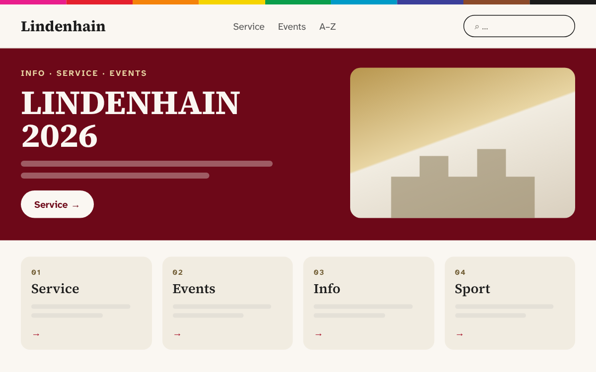

Warme Cremeflächen, Serifenschlagzeilen und ein kräftiger Akzent, ruhige Service-Karten. Passt zu: serviceorientierte Seiten; Standard für neue Seiten. Datei: [`civic.md`](https://github.com/DasRed/ai-instructions/blob/main/styleguides/civic.md)

### Bento

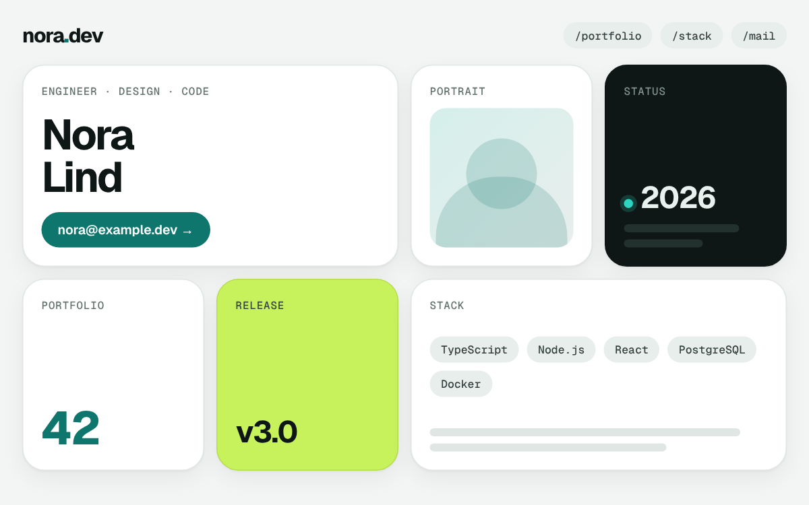

Kachelraster in Petrol mit einer dunklen Kontrastkachel und einer Lime-Kachel, hell und dunkel. Passt zu: Portfolios, Produktseiten, Dashboards. Datei: [`bento.md`](https://github.com/DasRed/ai-instructions/blob/main/styleguides/bento.md)

### Blockcraft

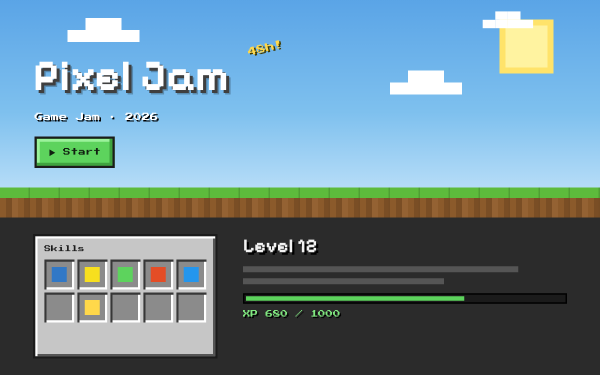

Voxel-Welt aus Himmel, Gras- und Steinblöcken, Pixelschrift, Inventar und XP-Leiste. Passt zu: Game-Jams, Coding-Kurse, Spiele-Communities. Datei: [`blockcraft.md`](https://github.com/DasRed/ai-instructions/blob/main/styleguides/blockcraft.md)

### Blueprint

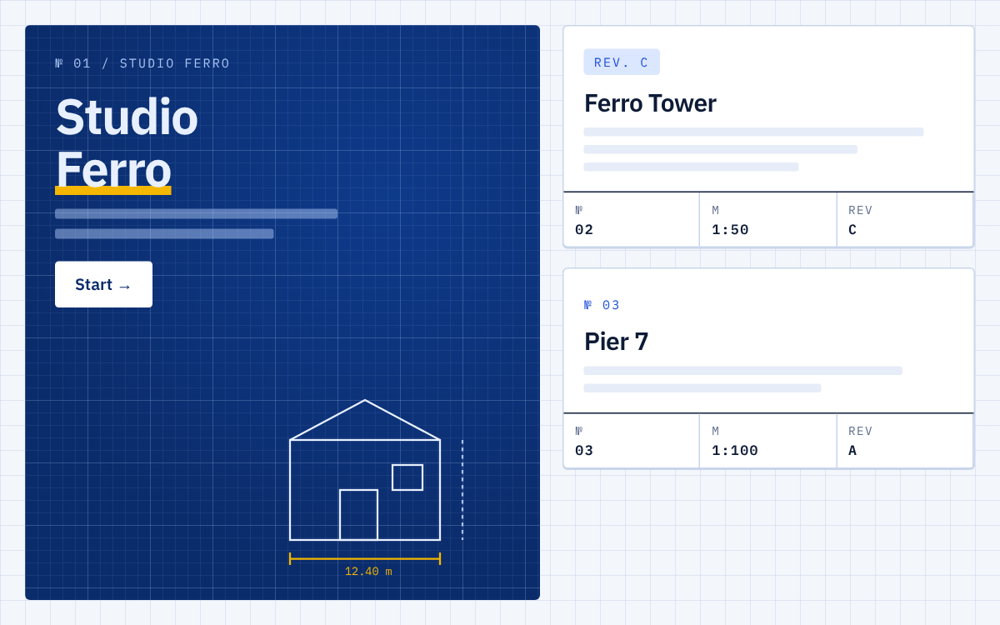

Rasterpapier, tiefblaue Blaupausen mit Maßlinien, Zeichnungsblätter mit Schriftfeld, Bleistiftgelb. Passt zu: Ingenieurbüros, Architektur, technische Beratung. Datei: [`blueprint.md`](https://github.com/DasRed/ai-instructions/blob/main/styleguides/blueprint.md)

### Comic

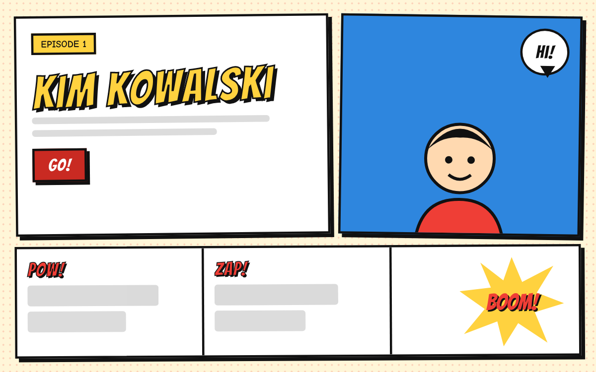

Zeitungspapier mit Rasterpunkten, Panels mit dicker Tusche, Sprechblasen und Soundeffekte. Passt zu: Events, Kinder- und Jugendangebote, Produktlaunches. Datei: [`comic.md`](https://github.com/DasRed/ai-instructions/blob/main/styleguides/comic.md)

### Cosmos

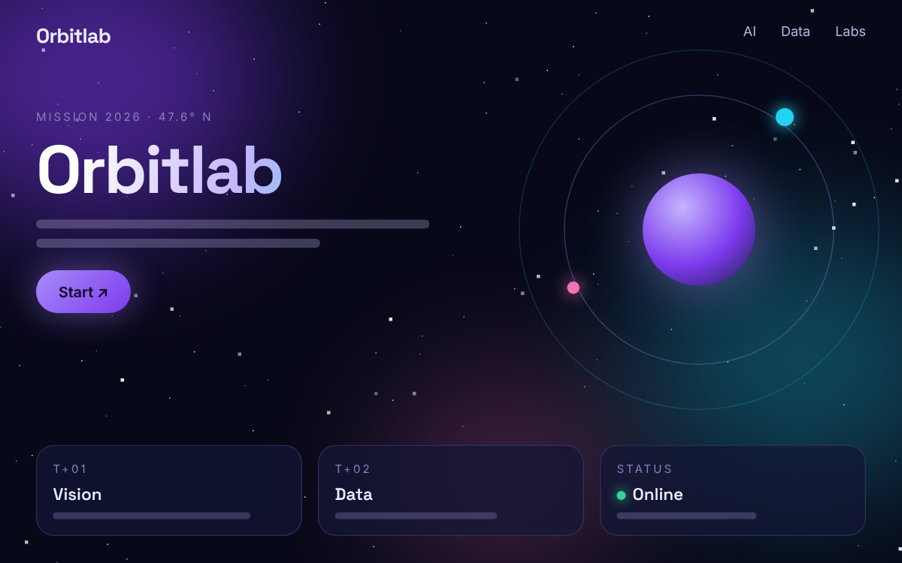

Tiefer Weltraum mit Sternen und Nebeln, Verlaufsüberschrift, Glaskarten und Planetenbahnen. Passt zu: Tech-Startups, KI- und Datenprodukte, Astronomie. Datei: [`cosmos.md`](https://github.com/DasRed/ai-instructions/blob/main/styleguides/cosmos.md)

### DasRed

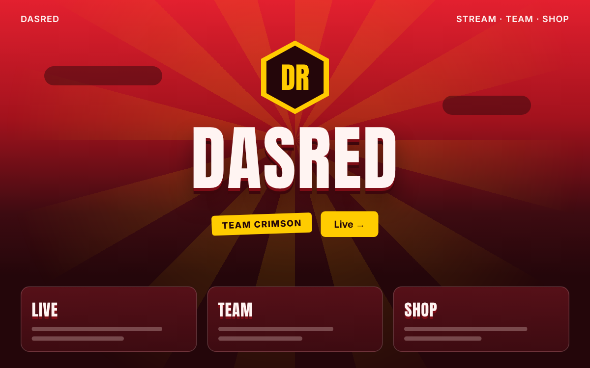

Roter Himmel über Purpurnacht, goldene Strahlen, goldenes Emblem und Name mit gestaffeltem Schatten. Passt zu: Marken, Teams, Streamer mit roter Identität. Datei: [`dasred.md`](https://github.com/DasRed/ai-instructions/blob/main/styleguides/dasred.md)

### Editorial

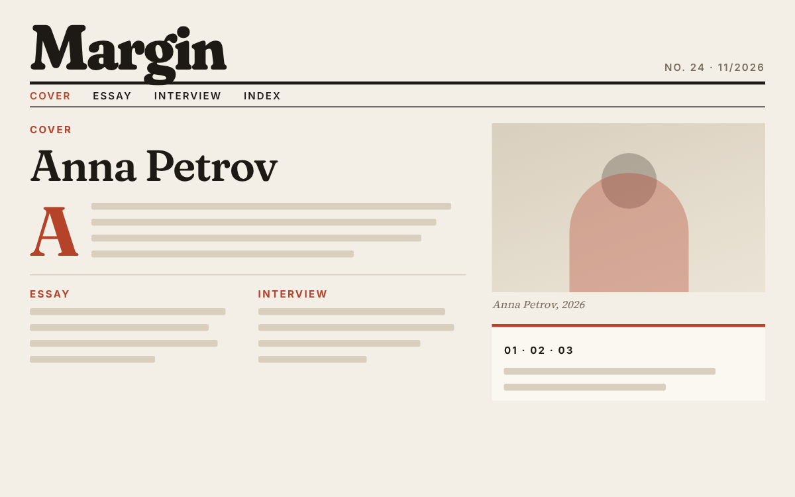

Zeitschrift auf warmem Papier: Zeitschriftenkopf, Titelgeschichte mit Initiale, Faktenkasten, Rostrot. Passt zu: Autoren, Beratungen, Kultur, lange Texte. Datei: [`editorial.md`](https://github.com/DasRed/ai-instructions/blob/main/styleguides/editorial.md)

### Hello World

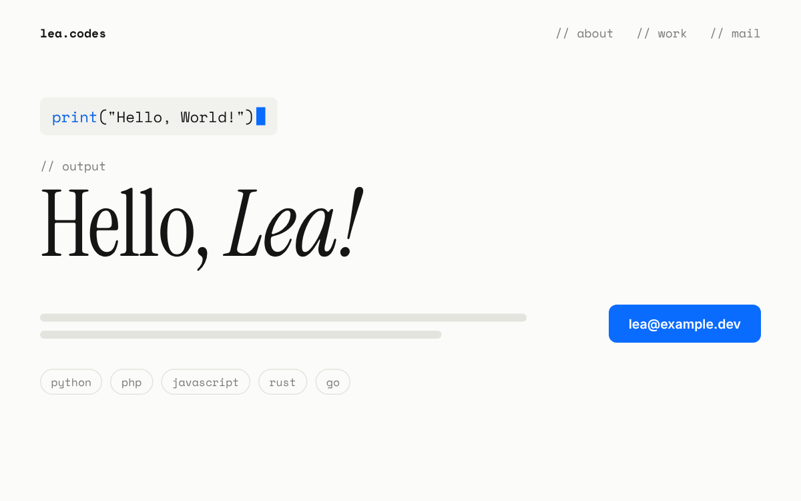

Weißes Papier, eine Codezeile mit blinkendem Cursor und darunter die Ausgabe als große Serifenschrift. Passt zu: Entwickler-Portfolios, Dev-Tools, technische Blogs. Datei: [`hello-world.md`](https://github.com/DasRed/ai-instructions/blob/main/styleguides/hello-world.md)

### Narf

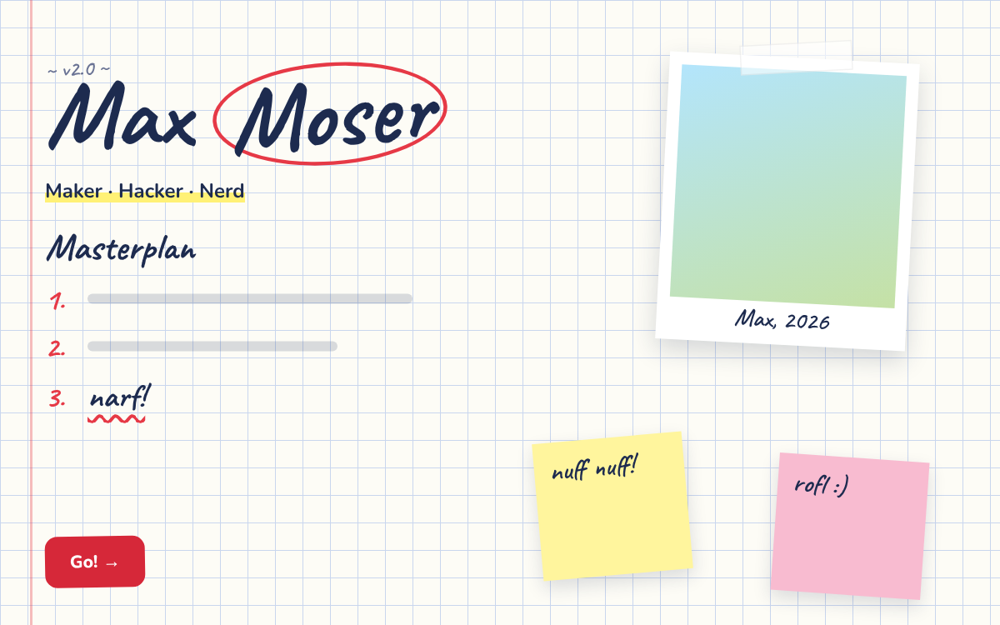

Laborbuch auf Karopapier, Handschrift, Textmarker, rote Kreise, eingeklebtes Foto und Klebezettel. Passt zu: Maker-Portfolios, Hackspaces, Side-Projects. Datei: [`narf.md`](https://github.com/DasRed/ai-instructions/blob/main/styleguides/narf.md)

### Philipp

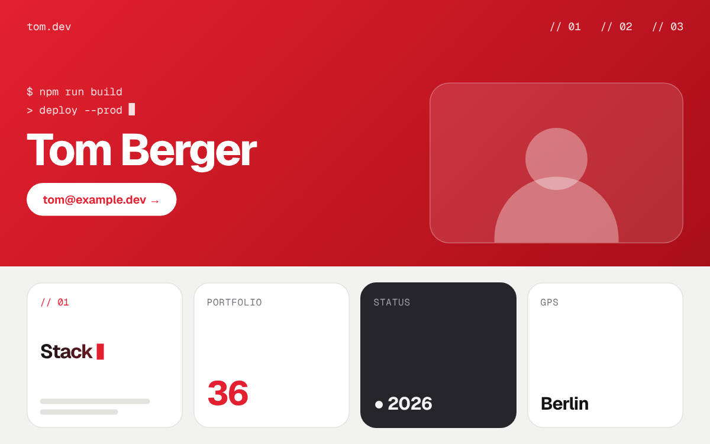

Roter Einstieg mit Code-Zeilen, kräftige Sans-Überschrift, Porträt-Kachel und Bento-Reihe darunter. Passt zu: Freelancer, Agenturen, Dev-Tools mit kräftiger Markenfarbe. Datei: [`philipp.md`](https://github.com/DasRed/ai-instructions/blob/main/styleguides/philipp.md)

### Retro 90s

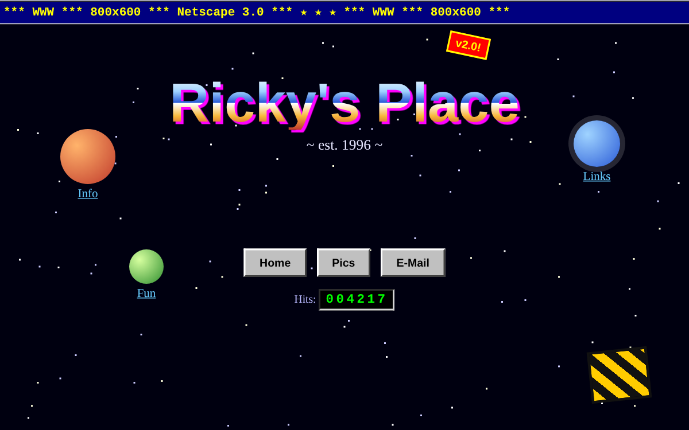

Homepage von 1996: Sternenhimmel, Chrom-Lettern, Planeten als Navigation, graue 3D-Knöpfe, Besucherzähler. Passt zu: Jubiläen, Retro-Events, Spaßseiten. Datei: [`retro90s.md`](https://github.com/DasRed/ai-instructions/blob/main/styleguides/retro90s.md)

### Studio

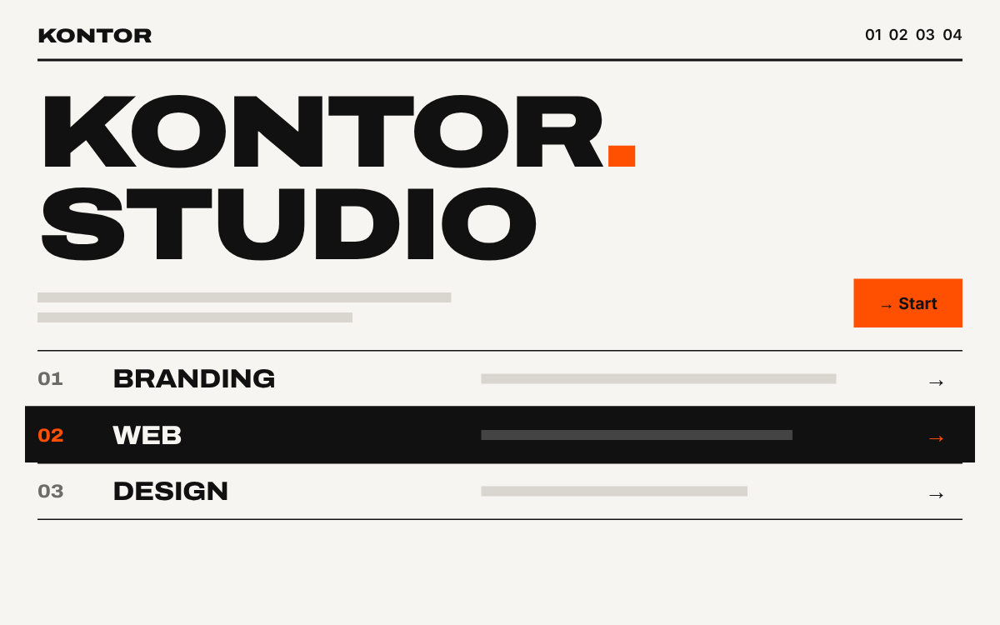

Schweizer Raster: riesige breite Versalien, schwarze Linien, nummerierte Zeilen, Signalorange. Passt zu: Agenturen, Studios, Beratungen. Datei: [`studio.md`](https://github.com/DasRed/ai-instructions/blob/main/styleguides/studio.md)

### Superhero

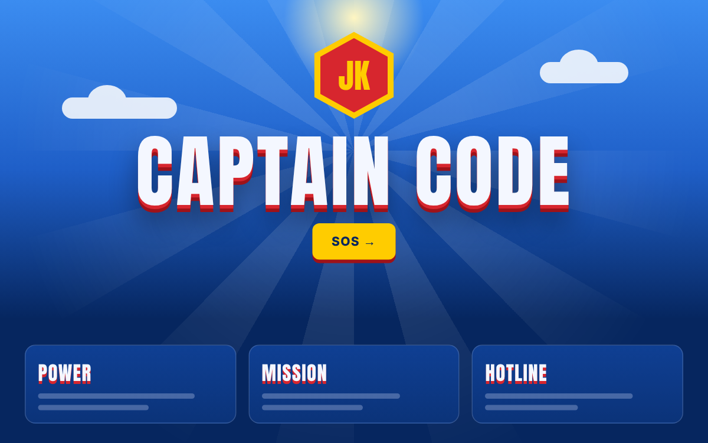

Blauer Himmel mit Sonnenstrahlen und Wolken, eigenes Emblem, Name mit rotem Schatten, Sonnengelb. Passt zu: Freelancer, Notfall-Services, Kampagnen. Datei: [`superhero.md`](https://github.com/DasRed/ai-instructions/blob/main/styleguides/superhero.md)

### Terminal

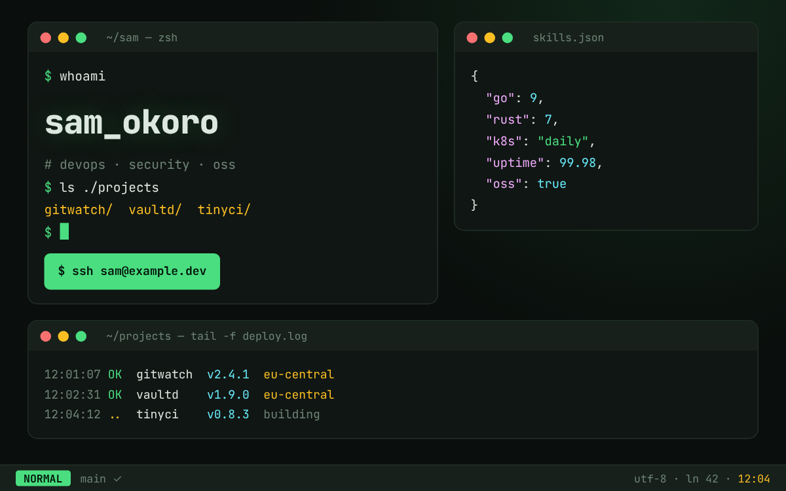

Dunkle Shell mit Fenstern, Prompt, getippten Befehlen, Syntax-Highlighting und Statuszeile. Passt zu: Dev-Tools, CLIs, Open Source, DevOps. Datei: [`terminal.md`](https://github.com/DasRed/ai-instructions/blob/main/styleguides/terminal.md)

## Aufbau eines Styleguides

Die meisten Styleguides folgen demselben Gerüst:

| Abschnitt          | Inhalt                                                              |
|--------------------|---------------------------------------------------------------------|
| Zweck, Kurzfassung | wofür der Stil gedacht ist und wie er in einem Absatz aussieht      |
| Leitidee           | die Grundgedanken, an denen sich jede Entscheidung orientiert       |
| Farben und Rollen  | jede Farbe mit Wert und Aufgabe (Fläche, Text, Aktion, Status …)    |
| Typografie         | Schriften, Größen, Gewichte                                         |
| Layout, Komponenten, Bewegung | Raster, Flächen, typische Bausteine, Animationen         |
| Dos und Don'ts     | Prüfliste für das fertige Ergebnis                                  |
| Tokens als CSS     | Farbrollen als CSS-Variablen zum Übernehmen                         |
| Kompakter Prompt   | der Stil in wenigen Sätzen, direkt für einen Agenten                |

Civic weicht davon ab: Statt Tokens und kompaktem Prompt hat es einen Abschnitt „Anwendung auf ein anderes Projekt“
mit eigener Prüfliste.

## Verwenden

Gib dem Agenten den ganzen Styleguide und sag, was vom Projekt kommt:

```markdown
Design the landing page following ~/Web/ai/styleguides/bento.md.
Keep layout, typography and components, but replace the petrol accent with our brand colour #1F6FEB.
Check the result against section "Dos und Don'ts" before you finish.
```

Für einen schnellen Entwurf reicht oft der Abschnitt „Kompakter Prompt“ am Ende der Datei.

> [!IMPORTANT]
> Einige Styleguides lehnen sich an bekannte Motive an (Comics, Block-Spiele, Superhelden). Übernommen werden nur
> Prinzipien und Stimmung, nie Figuren, Logos, Wappen oder andere geschützte Motive.
