The folder [`styleguides/`](https://github.com/DasRed/ai-instructions/tree/main/styleguides) holds one file per design
style. A styleguide describes colours and their roles, typography, layout, components, motion and a checklist – precise
enough for an agent to build a page from it without seeing a reference. The styleguides are written in German.

## Overview

The previews are sample pages built from the colours, fonts and components of each styleguide. Names and contents in them are made up. Exception: Contour, Graphite, Noir, Plum and Sunset grew out of the design drafts for aspect42; their previews show those drafts in the aspect42 colours.

### Civic

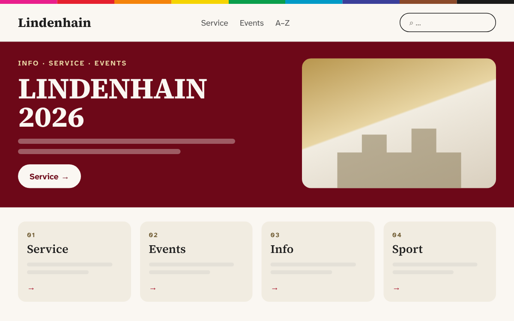

Warm cream surfaces, serif headlines and one strong accent, calm service cards. Suits: service-oriented sites; default for new sites. File: [`civic.md`](https://github.com/DasRed/ai-instructions/blob/main/styleguides/civic.md)

### Bento

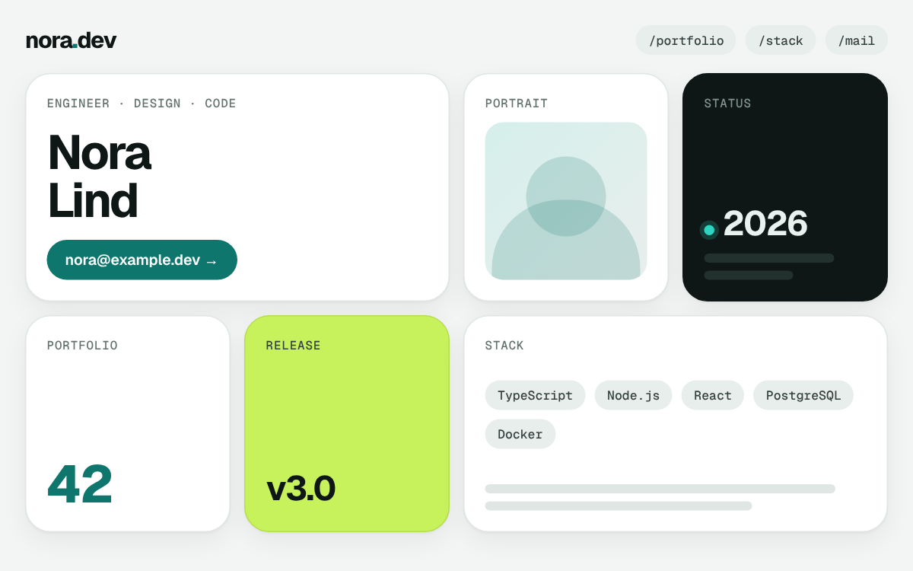

Tile grid in petrol with one dark contrast tile and one lime tile, light and dark. Suits: portfolios, product pages, dashboards. File: [`bento.md`](https://github.com/DasRed/ai-instructions/blob/main/styleguides/bento.md)

### Blockcraft

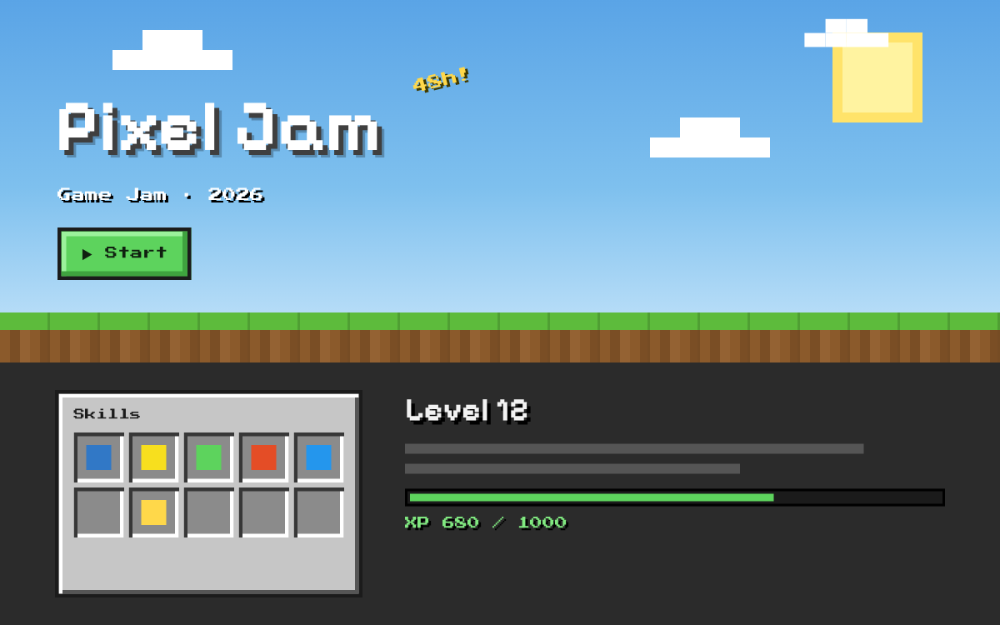

Voxel world of sky, grass and stone blocks, pixel font, inventory and XP bar. Suits: game jams, coding courses, gaming communities. File: [`blockcraft.md`](https://github.com/DasRed/ai-instructions/blob/main/styleguides/blockcraft.md)

### Blueprint

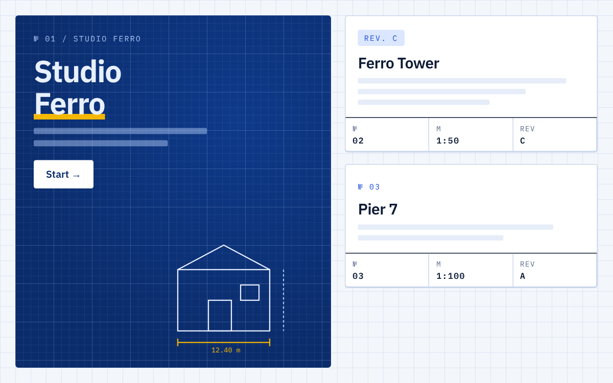

Grid paper, deep blue blueprints with dimension lines, drawing sheets with title blocks, pencil yellow. Suits: engineering offices, architecture, technical consulting. File: [`blueprint.md`](https://github.com/DasRed/ai-instructions/blob/main/styleguides/blueprint.md)

### Comic

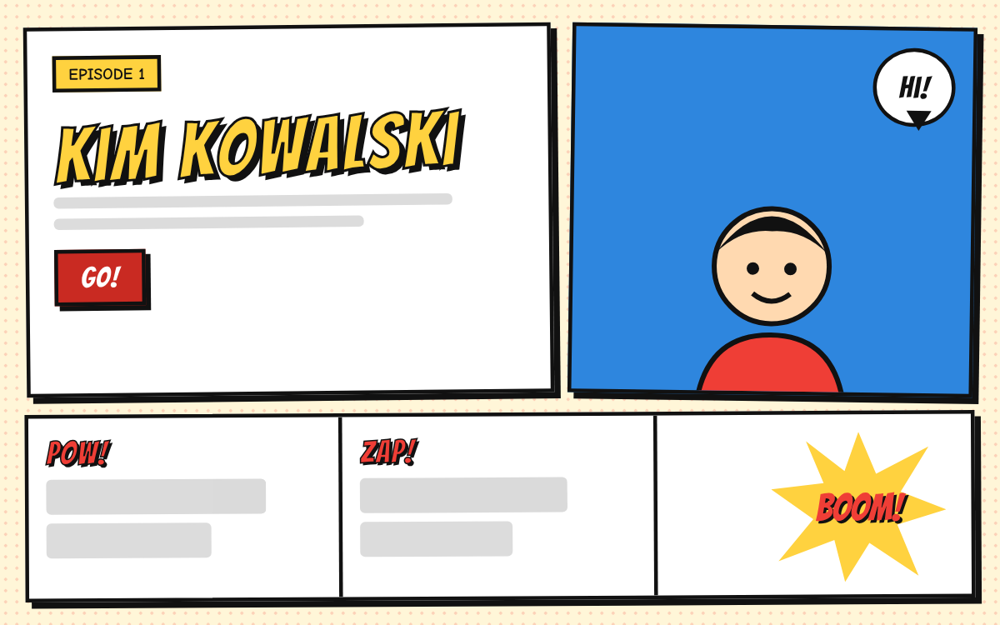

Newsprint with halftone dots, panels in thick ink, speech bubbles and sound effects. Suits: events, offers for kids and teens, product launches. File: [`comic.md`](https://github.com/DasRed/ai-instructions/blob/main/styleguides/comic.md)

### Contour

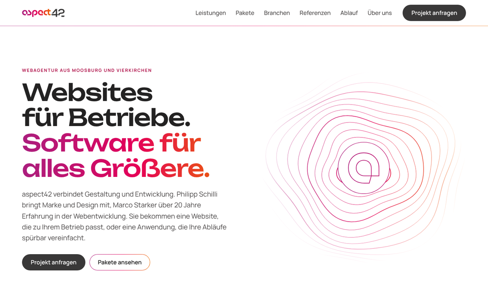

Everything in lines on white: topographic contour lines, 1 px gradient borders, outlined numerals, colour never as a surface. Suits: agencies, design studios, brands with an outline logo or a gradient. File: [`contour.md`](https://github.com/DasRed/ai-instructions/blob/main/styleguides/contour.md)

### Cosmos

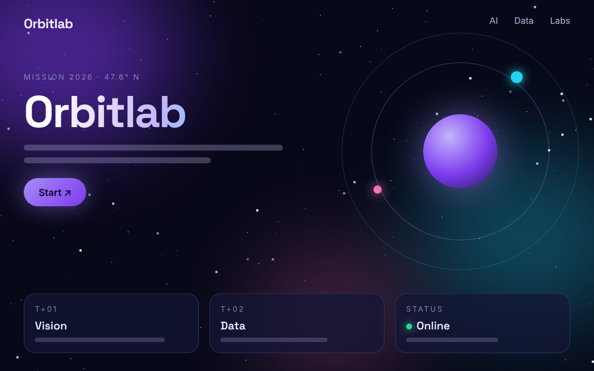

Deep space with stars and nebulae, gradient headline, glass cards and orbits. Suits: tech start-ups, AI and data products, astronomy. File: [`cosmos.md`](https://github.com/DasRed/ai-instructions/blob/main/styleguides/cosmos.md)

### DasRed

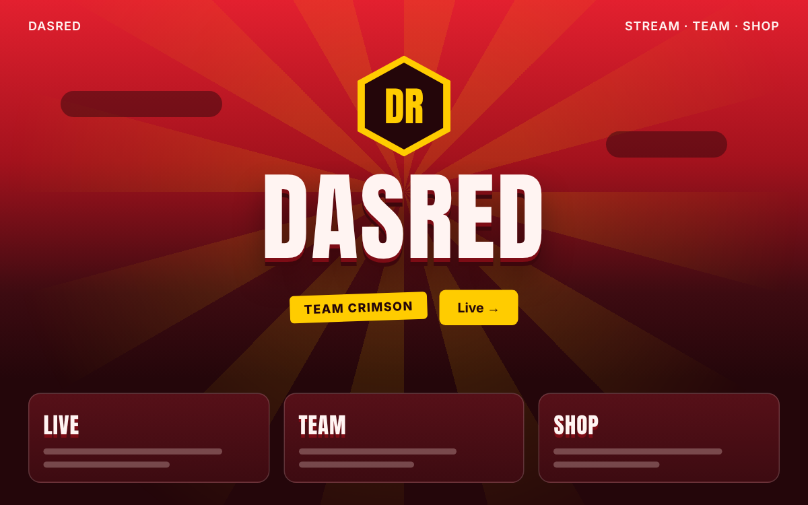

Red sky over purple night, golden rays, golden emblem and a name with stacked shadow. Suits: brands, teams, streamers with a red identity. File: [`dasred.md`](https://github.com/DasRed/ai-instructions/blob/main/styleguides/dasred.md)

### Editorial

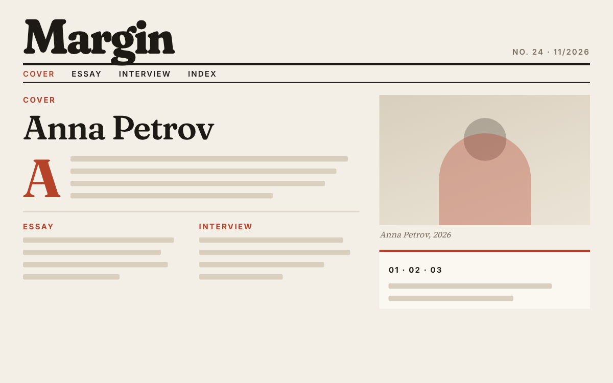

Magazine on warm paper: masthead, cover story with drop cap, fact box, rust red. Suits: authors, consultancies, culture, long reads. File: [`editorial.md`](https://github.com/DasRed/ai-instructions/blob/main/styleguides/editorial.md)

### Graphite

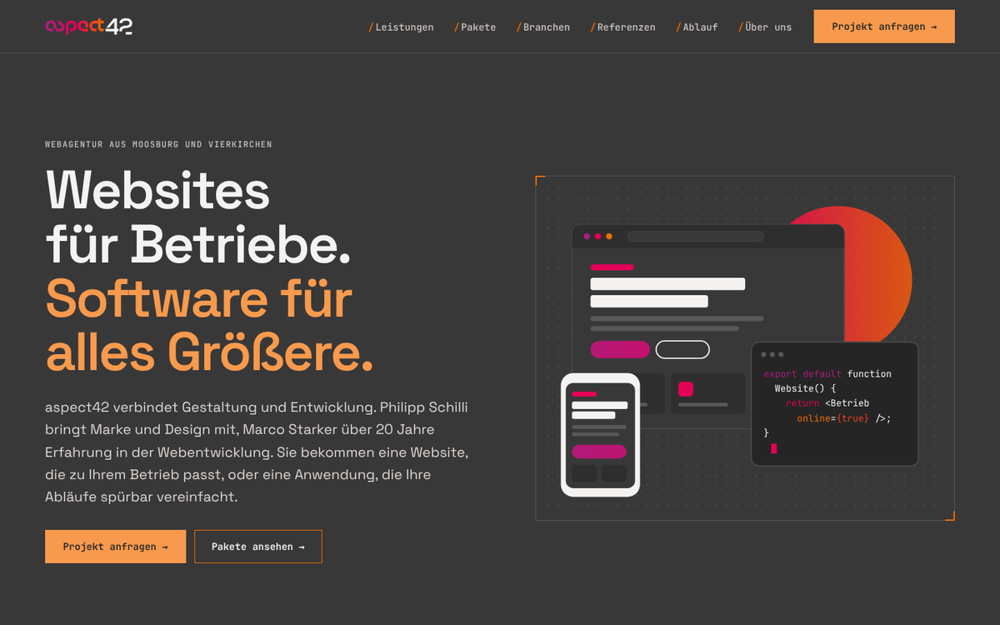

Logo anthracite as the page colour, outline wordmark as key visual, frames with orange corner marks, mono labels in brackets. Suits: development agencies, IT services, technical products. File: [`graphite.md`](https://github.com/DasRed/ai-instructions/blob/main/styleguides/graphite.md)

### Hello World

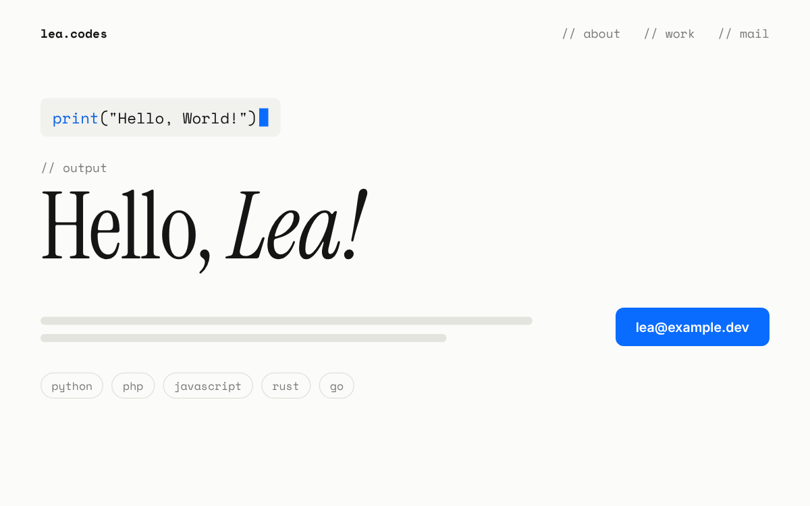

White paper, a line of code with a blinking cursor and its output below in a large serif. Suits: developer portfolios, dev tools, tech blogs. File: [`hello-world.md`](https://github.com/DasRed/ai-instructions/blob/main/styleguides/hello-world.md)

### Narf

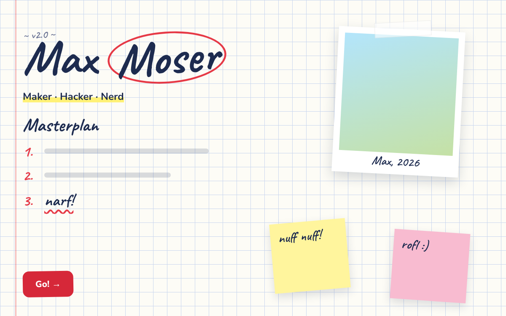

Lab notebook on grid paper, handwriting, highlighter, red circles, taped photo and sticky notes. Suits: maker portfolios, hackspaces, side projects. File: [`narf.md`](https://github.com/DasRed/ai-instructions/blob/main/styleguides/narf.md)

### Noir

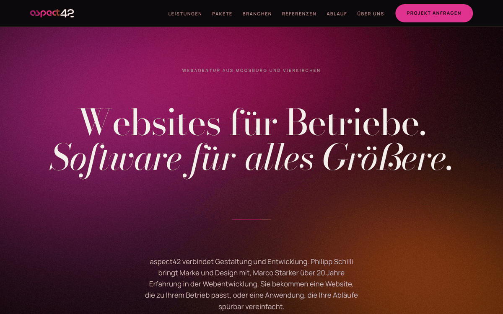

Deep black, large Bodoni with an italic counter-voice, hairlines, generated fields of light in the brand colours. Suits: ambitious agencies and studios, architecture, culture. File: [`noir.md`](https://github.com/DasRed/ai-instructions/blob/main/styleguides/noir.md)

### Philipp

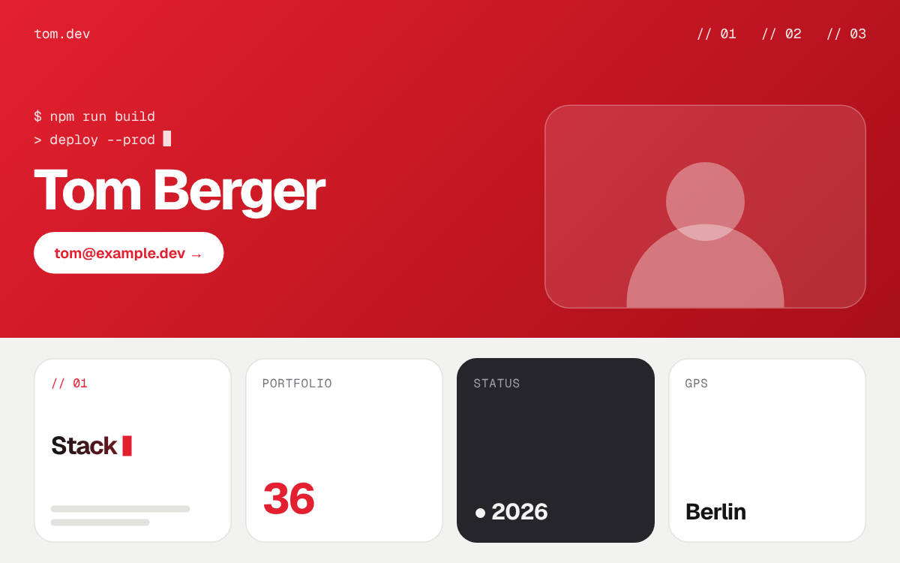

Red hero with lines of code, bold sans headline, portrait tile and a bento row below. Suits: freelancers, agencies, dev tools with a strong brand colour. File: [`philipp.md`](https://github.com/DasRed/ai-instructions/blob/main/styleguides/philipp.md)

### Plum

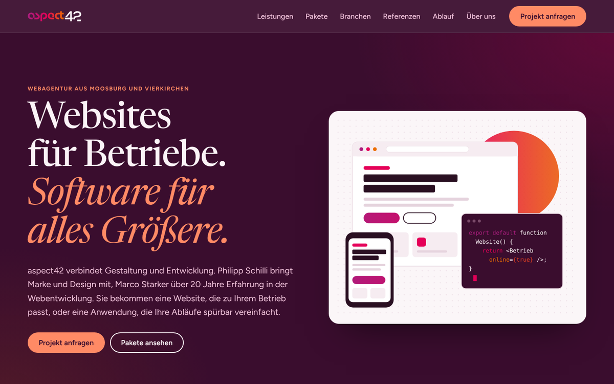

Plum and blush alternating, coral as the action colour on dark, Newsreader with italic accents, arched portraits. Suits: coaching, consulting, agencies, culture. File: [`plum.md`](https://github.com/DasRed/ai-instructions/blob/main/styleguides/plum.md)

### Retro 90s

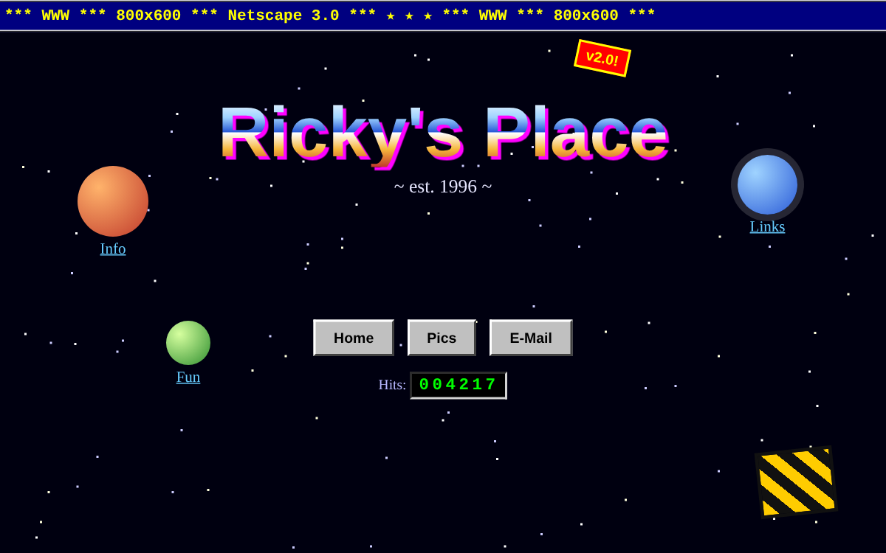

Homepage from 1996: starfield, chrome lettering, planets as navigation, grey 3D buttons, hit counter. Suits: anniversaries, retro events, fun pages. File: [`retro90s.md`](https://github.com/DasRed/ai-instructions/blob/main/styleguides/retro90s.md)

### Studio

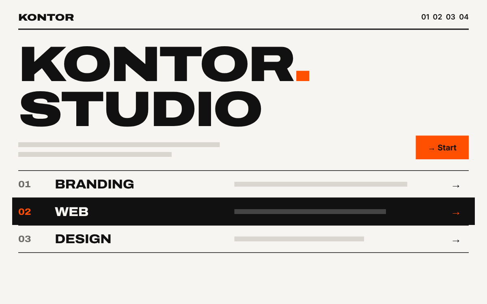

Swiss grid: huge wide capitals, black rules, numbered rows, signal orange. Suits: agencies, studios, consultancies. File: [`studio.md`](https://github.com/DasRed/ai-instructions/blob/main/styleguides/studio.md)

### Sunset

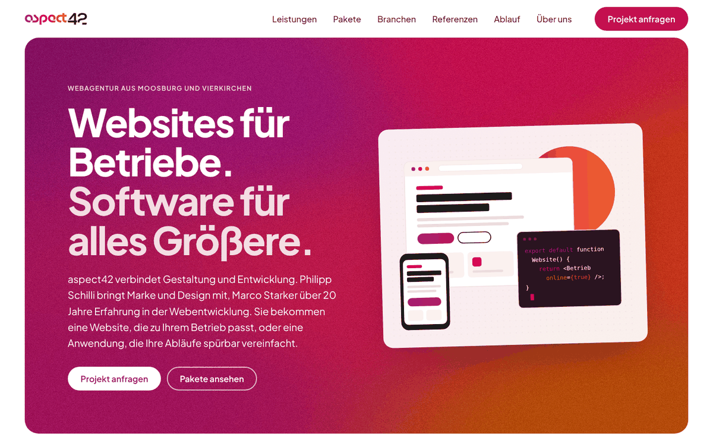

Large grainy gradient panels at the start and end of every page, soft white cards in between. Suits: agencies, start-ups, apps, brands with a gradient. File: [`sunset.md`](https://github.com/DasRed/ai-instructions/blob/main/styleguides/sunset.md)

### Superhero

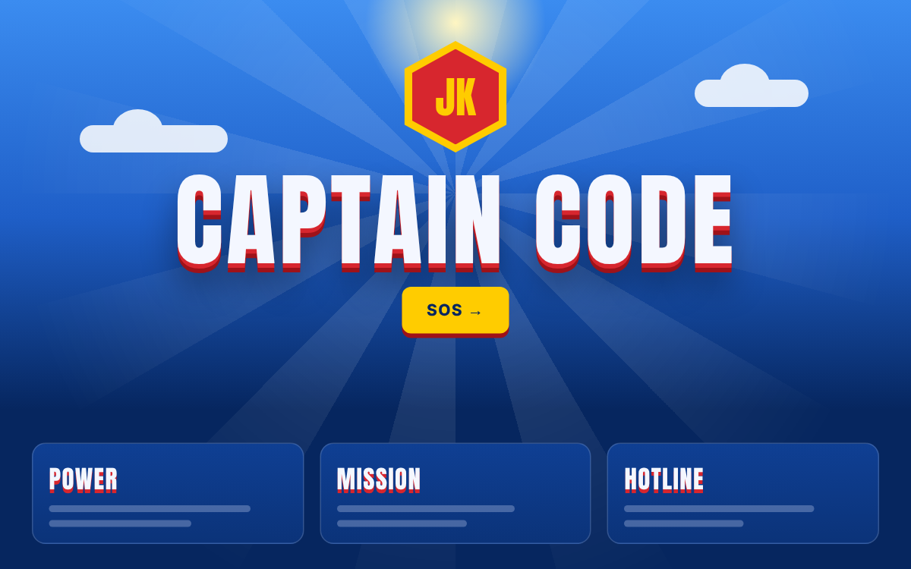

Blue sky with sun rays and clouds, own emblem, name with red shadow, sun yellow. Suits: freelancers, emergency services, campaigns. File: [`superhero.md`](https://github.com/DasRed/ai-instructions/blob/main/styleguides/superhero.md)

### Terminal

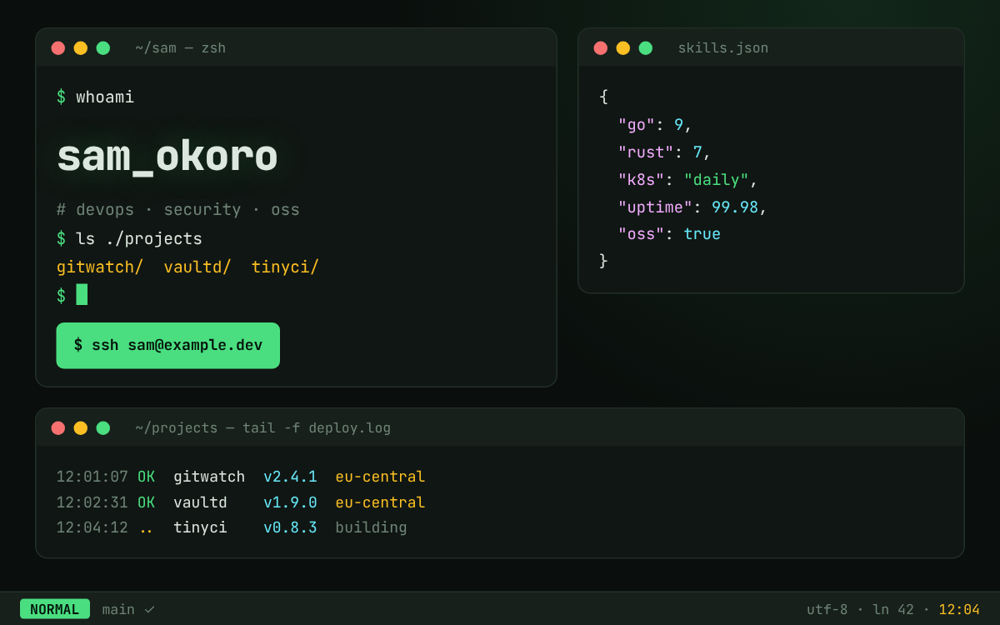

Dark shell with windows, prompt, typed commands, syntax highlighting and a status bar. Suits: dev tools, CLIs, open source, DevOps. File: [`terminal.md`](https://github.com/DasRed/ai-instructions/blob/main/styleguides/terminal.md)

## Structure of a styleguide

Most styleguides follow the same outline:

| Section                       | Contents                                                       |
|-------------------------------|----------------------------------------------------------------|
| Purpose, summary              | what the style is for and what it looks like in one paragraph  |
| Guiding idea                  | the principles every decision follows                          |
| Colours and roles             | every colour with value and job (surface, text, action, state …) |
| Typography                    | fonts, sizes, weights                                          |
| Layout, components, motion    | grid, surfaces, typical building blocks, animations            |
| Dos and don'ts                | checklist for the finished result                              |
| Tokens as CSS                 | colour roles as CSS variables to copy                          |
| Compact prompt                | the style in a few sentences, ready for an agent               |

Civic differs: instead of tokens and a compact prompt it has a section on applying it to another project, with its own
checklist.

## Usage

Give the agent the whole styleguide and say what comes from the project:

```markdown
Design the landing page following ~/Web/ai/styleguides/bento.md.
Keep layout, typography and components, but replace the petrol accent with our brand colour #1F6FEB.
Check the result against section "Dos und Don'ts" before you finish.
```

For a quick draft the "Kompakter Prompt" (compact prompt) section at the end of the file is often enough.

> [!IMPORTANT]
> Some styleguides draw on well-known motifs (comics, block games, superheroes). Only principles and mood are taken
> over, never characters, logos, crests or other protected motifs.
